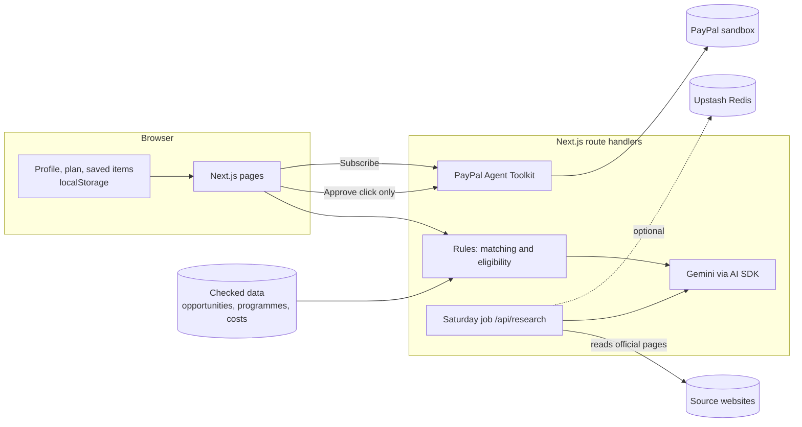

# Hapi – your next step abroad

Hapi is one place for students to find opportunities abroad and plan the money for them. It covers hackathons, competitions, scholarships, certificates, courses, internships and events, free and paid. It also checks which bachelor programmes in Austria, Germany and Italy a student can apply to, and shows the real total cost in one plan. A family member can sponsor any cost through a PayPal invoice, and nothing is sent until the student approves it.

**Live app:** https://hapi-abroad.vercel.app · **Try everything at once:** add `?demo=1` to any page (a made-up sample student; your own data comes back when you leave demo mode).

PayPal runs in **sandbox mode**. No real money moves.

## Features

| Feature | What it does |
|---|---|
| Profile first | Nationality (with spelling help, so "Alllbaniii" or "shqiperi" becomes Albania), age, 13 education stages from middle school and HTL to PhD and working, Austrian school abroad, languages with CEFR levels, a university budget and a budget per opportunity. Then the student chooses universities or opportunities. |
| Opportunities feed | 210 checked opportunities, each with its source link, every known date and the real price. Unknown dates show "TBA". Sort by best match, deadline or price; filters for type, free or paid, within my budget, travel paid, certificate, online and closing soon. |
| Matching | Code first applies the hard rules: age, nationality (worldwide, EU, Western Balkans, single-country and other rules) and who can apply (school pupils, bachelor, master, PhD, graduates). Items above the student's budget are flagged. Only then does it score interests and deadlines, so what the student can apply to always comes first. Gemini writes one "why this fits you" line from those facts only. |
| Find more with AI | Gemini with Google Search suggests more. Each result must point to one of the search sources, and stays marked "unverified". |
| Universities | 596 bachelor programmes at 142 universities in 35 countries, mostly in Austria, Germany and Italy, grouped by university. Each shows the fee this student would pay: EU or non-EU by nationality, equal status for Austrian schools abroad, income-based fees in Italy. Code checks language level and that fee against the budget, and flags data that still needs checking. |
| Scholarships | A separate view per country: scholarships the student applies to directly, checked against their profile, plus the scholarship notes for each university. |
| Cost plan | An editable AG Grid table with totals per currency and a sponsored progress bar. A paid opportunity, or a university's one-off fees, can be added with one click. |
| Family sponsorship | The student describes the request in their own words. Gemini drafts a PayPal invoice, and an approval card shows exactly what will be sent. Only the Approve button sends it. The status (sent, paid) can be refreshed. |
| Hapi Premium | A €2.99/month PayPal subscription. The server checks that the subscription is ACTIVE before the coach or the CV AI answers. |
| Community | With an account, students can like opportunities, rate them, write reviews by the year they took part, and ask or answer questions. Each student has a public page with their first name, likes and reviews. Everyone can read; only the author can change their own posts (row-level security in Supabase). |
| Weekly coach | Up to 5 steps for this week, built only from checked opportunities that the student is eligible for, their saved items and their unpaid costs. Every step links to its official page. |
| Ask Hapi chat | A chat assistant for Premium users. The server checks the subscription, then gives the AI only the student's profile and the opportunities and programmes that code has already matched to them, so it answers from checked data and says when it does not know. The chat stays in the browser. |
| Step-by-step plan | For every programme the student wants to apply to: language certificate, entry test, application, visa (only if their passport needs one), housing and arrival. The application deadline is official; the other dates are suggestions worked out backwards from it. |
| Reminders | A "Coming up" list of everything due in the next two weeks, optional browser notifications three days before, and reminders in the calendar export. |
| WhatsApp for sponsors | After a PayPal invoice is sent, the student can share the payment link with the sponsor on WhatsApp in one tap. |
| Hapi in numbers | A statistics page (/stats): opportunities in the data, profiles by country, what students save, how often the AI features are used, what the weekly AI job checked and corrected, cost plans, sponsor invoices and a one-question survey. Usage is counted anonymously: only the kind of action and a country, never a name, email or account id. |
| Accessibility | Checked with axe against WCAG 2.1 AA on 10 pages: no violations after the fixes. Every form field has a name for screen readers, text contrast is at least 4.5 : 1 on the dark background, and all animations stop when the device asks for reduced motion. |
| Calendar | Every saved deadline, starred programme and cost-plan payment in a month view, plus the steps of the step-by-step plan, with an .ics export that reminds the student two weeks, three days and one day before each deadline. Premium only. |
| Europass CV | A CV builder in the structure of the EU's Europass CV: personal information, work experience, education with EQF levels, languages on the CEFR self-assessment grid, digital skills and more. "Improve with AI" rewrites the student's own words without adding facts, and asks what could be added. Print or save as PDF. Premium only, checked on the server. |
| What changed this week | Every Saturday a Vercel Cron job re-reads the official page of a few open opportunities and reports changed dates, closed rounds and new editions. |

## How it works



**Rules first, AI second.** Code decides eligibility, deadlines and prices from the checked data. The model only explains or orders what code already decided, and every AI answer is checked against known IDs or source links before it is shown. The model never gets a PayPal tool: the server calls PayPal only after the student clicks a button.

## PayPal tools used

All calls go through the [PayPal Agent Toolkit](https://github.com/paypal/agent-toolkit) (`@paypal/agent-toolkit/ai-sdk`) in the sandbox.

| Tool | Used for |
|---|---|
| `create_invoice` | Draft the sponsor invoice after the student approves it |
| `send_invoice` | Send it to the family member |
| `get_invoice` | Refresh the invoice status in the cost plan |
| `create_product` | Create the "Hapi Premium" product once |
| `list_subscription_plans` | Reuse the existing monthly plan |
| `create_subscription_plan` | Create the €2.99 monthly plan once |
| `create_subscription` | Start a subscription and get the PayPal approval link |
| `show_subscription_details` | Check that a subscription is ACTIVE before the coach answers |

## Run it yourself

Requirements: Node.js 20 or newer, a [Google AI Studio](https://aistudio.google.com/) API key, and a [PayPal Developer](https://developer.paypal.com/) sandbox app.

```bash
git clone https://github.com/Devvzz/hapi.git
cd hapi
npm install
cp .env.example .env.local
npm run dev
```

Fill in `.env.local`:

| Variable | Needed | What it is |
|---|---|---|
| `GOOGLE_GENERATIVE_AI_API_KEY` | yes | Gemini API key |
| `PAYPAL_CLIENT_ID`, `PAYPAL_CLIENT_SECRET` | yes | Sandbox app credentials |
| `PAYPAL_ENVIRONMENT` | yes | Keep `SANDBOX` |
| `GEMINI_MODEL` | no | Main model, default `gemini-flash-lite-latest` |
| `PAYPAL_PREMIUM_PLAN_ID` | no | Pin an existing plan; otherwise one is found or created |
| `NEXT_PUBLIC_SUPABASE_URL`, `NEXT_PUBLIC_SUPABASE_ANON_KEY` | no | Turns on accounts: sign up with email and password, data synced to one private row per user |
| `HAPI_DEMO` | no | Set to `off` to stop demo mode from unlocking the coach |
| `CRON_SECRET` | for the job | Protects `/api/research`; Vercel sends it automatically |
| `UPSTASH_REDIS_REST_URL`, `UPSTASH_REDIS_REST_TOKEN` | no | Stores the latest Saturday run; without them the app shows the saved example run |

**Accounts (optional):** create a free [Supabase](https://supabase.com) project, turn off "Confirm email" under Authentication, run `supabase/setup.sql`, then `supabase/community.sql` and `supabase/stats.sql` in the SQL Editor, and set `NEXT_PUBLIC_SUPABASE_URL` and `NEXT_PUBLIC_SUPABASE_ANON_KEY`. Without them, Hapi saves everything in the browser only.

To approve a Premium subscription in the sandbox you need a sandbox **personal** (buyer) account from the PayPal Developer dashboard. Demo mode unlocks the coach without one.

## Data

The data was researched and checked by hand before the build (31 Oct – 6 Nov 2026), with a source link and a `lastChecked` date on every item.

- `data/opportunities.json`: 210 opportunities. Each says who can apply by education level, and 78 have a nationality rule read from the official page, with a quote as evidence. Pages that set no nationality limit count as open to everyone. By default the app shows only what a student can apply to; the rest is listed as "does not apply to you" and can be shown on request.
- `data/programs.json`: 596 bachelor programmes in 35 countries (10 checked in detail, the rest from an earlier atlas plus 41 newly researched programmes, cleaned, with a confidence level for tuition)
- `data/costs.json`: 22 official fees and costs
- `data/example-run.json`: a real run of the Saturday job, shown until storage is set up

The data is for all students. Without an account, nothing about the student is stored on a server: everything stays in the browser. With an account, the same data is saved in one private row per user in Supabase (EU), protected by row-level security so only that user can read it.

## Limitations

- Dates and prices change. Every item links to its official page, and values marked "check yourself" are not confirmed.
- University rules are simplified: language level and non-EU tuition. Each university's own page decides.
- "Find more with AI" needs Google Search grounding, which the free Gemini tier may not allow. The checked list works without it.
- The Saturday job checks a few pages per run and reads only the page text, so pages built fully with JavaScript may show as unclear.
- Everything runs in the PayPal sandbox.

## AI tools used

Code built 7–12 Nov 2026; dataset researched before the event (31 Oct – 6 Nov); assisted by AI in coding.

- **Inside the app:** Google Gemini through the Vercel AI SDK (matching lines, Find more, invoice drafts, the coach, reading pages in the Saturday job).
- **While building:** an AI coding assistant, used to save time: drafting code, rechecking dates and prices in the data, and researching event rules. It assisted; it didn't build Hapi on its own.
- **What I did myself:** the idea, every product decision (audience, countries, features, PayPal sponsorship with approval, "rules first, AI second", pricing, data staying in the browser), the original data, and the review. I read through all of the code, found logic mistakes and fixed them, and checked the data and the app myself.

## License

[MIT](LICENSE)
